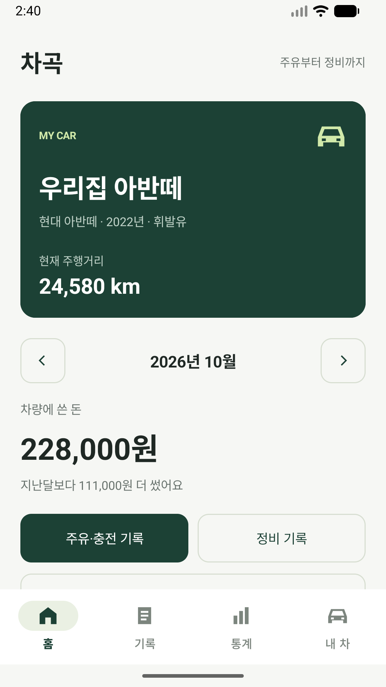
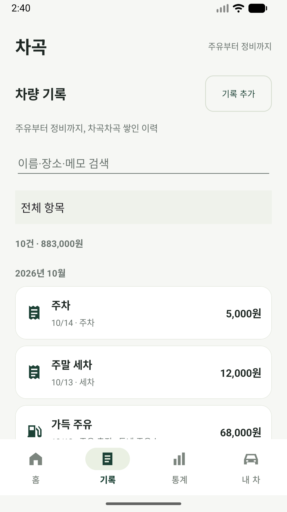
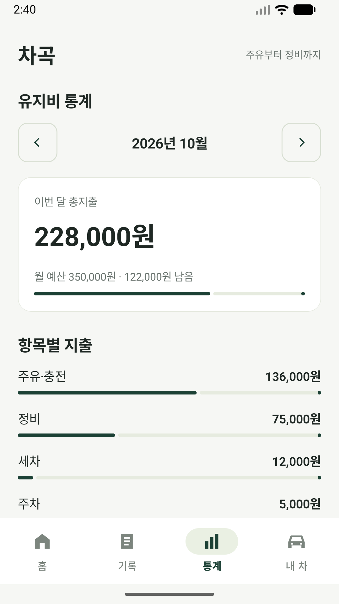
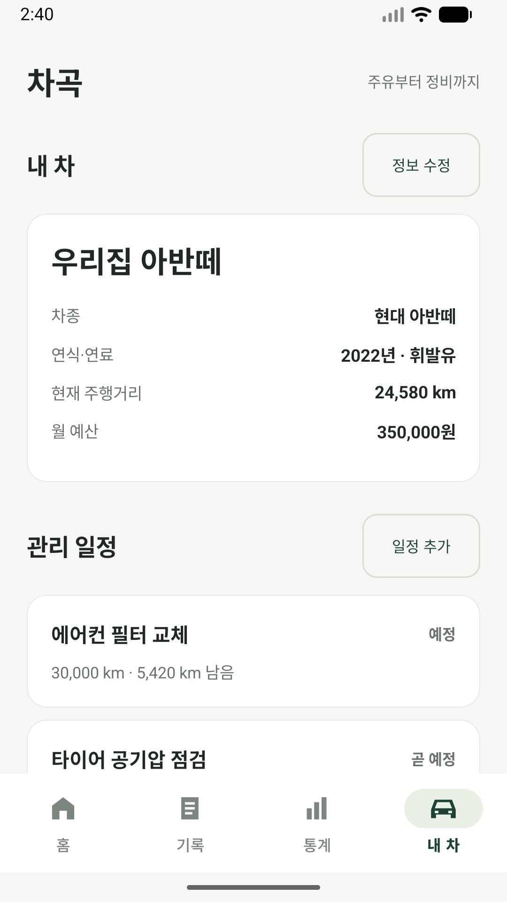

# 차곡 : 주유부터 정비까지

주유비는 얼마나 썼는지, 엔진오일은 언제 교체했는지, 다음 보험 만기는 언제인지.
**차곡**은 내 차의 지출과 관리 이력을 차곡차곡 정리하는 Android 앱입니다.


> 이 저장소는 실제 앱의 화면과 개발 구조를 소개하는 **공개 데모**입니다.
> UI와 데이터 모델 등 상당 부분을 공개하지만, 제품의 핵심 저장·복원·연비·광고·알림 구현은 포함하지 않습니다.
> 정식 앱의 전체 소스나 배포용 프로젝트가 아닙니다.

## 날짜별 작업 기록

- [2026-11-06](updates/2026-11-06/README.md) · 두 저장소를 합치고 개발 기록을 devlog 폴더로 이동
- [2026-10-27](updates/2026-10-27/README.md) · 앱 구조·개발 과정과 Kotlin 예제 게시
- [2026-10-15](updates/2026-10-15/README.md) · Android 데모와 앱 소개 첫 게시

[이후 업로드를 포함한 전체 날짜별 목록](updates/README.md)

## 앱 소개

차량 한 대를 직접 관리하는 사람을 위해 만들었습니다. 복잡한 설정이나 회원가입 없이 기록을 시작하고, 지출과 다음 관리 일정을 한곳에서 확인하는 것이 목표입니다.

| 화면 | 실제 앱에서 할 수 있는 일 |
| --- | --- |
| 홈 | 차량 정보·주행거리·월 유지비 확인, 주유·정비 빠른 기록, 임박한 일정 확인 |
| 기록 | 지출 검색, 항목별 필터, 상세 조회, 수정·삭제 |
| 통계 | 월별 총지출, 항목별 비중, 최근 6개월 변화, 월 예산, 주유·충전 단가와 연비 |
| 내 차 | 차량 정보 수정, 날짜·주행거리 기준 관리 일정, 완료 처리, 백업·복원·CSV, 일정 알림 |

주유·충전, 정비, 보험, 세금, 주차, 통행료, 세차, 기타 지출을 기록할 수 있습니다. 전기차는 충전량을 kWh로 기록합니다. 주행거리는 사용자가 직접 입력하며 GPS로 주행을 추적하지 않습니다.

## 화면

아래 이미지는 예시 기록을 넣어 촬영한 **실제 앱 화면**입니다. 화면을 AI로 생성하지 않았습니다. 대표 그래픽 이미지는 AI 생성 이미지이며 아이콘은 앱의 기존 벡터입니다.

<table>
  <tr><td align="center"><b>홈</b><br></td><td align="center"><b>기록</b><br></td></tr>
  <tr><td align="center"><b>통계</b><br></td><td align="center"><b>내 차</b><br></td></tr>
</table>

## 공개 데모에서 실행할 수 있는 기능

- 네 화면 탐색과 기존 디자인 확인
- 메모리의 예시 차량·지출·일정을 조회하고 수정
- 기록 검색·필터, 입력값 검증, 월별 합계와 기본 차트
- 날짜 선택, 차량·지출·일정 입력 시트

데모의 입력 내용은 프로세스가 종료되면 초기화됩니다. 파일 백업·복원·CSV, 일정 알림, 광고, 실제 연비 계산은 실행하지 않습니다. 제외한 기능은 화면에서 데모 안내로 표시합니다. 데모는 광고 SDK와 인터넷·알림 권한을 포함하지 않습니다.

## 코드와 구조

Kotlin, Android Views, Material Components를 사용한 네이티브 앱입니다. 하단 네 메뉴, Bottom Sheet 입력폼, 네이티브 날짜 선택기, 사용자 정의 차트로 구성했습니다. 오프화이트 배경과 짙은 녹색 포인트를 사용하고 금액과 기록을 중심에 배치했습니다.

```text
app/
├── src/main/java/com/silnoone/chagok/demo/
│   ├── ChagokActivity.kt     화면·입력폼·검색·통계 렌더링
│   ├── Models.kt             데이터 모델·기본 검증·표시용 집계
│   ├── CarStore.kt           공개 데모용 메모리 저장소
│   ├── AdsController.kt      광고 없이 UI 연결만 유지하는 대체 코드
│   └── ReminderJob.kt        예약 작업을 실행하지 않는 대체 코드
├── src/main/res/             테마·색상·아이콘·리소스 ID
├── src/test/                 공개 모델의 단위 테스트
└── src/androidTest/          네 화면을 여는 데모 UI 테스트
docs/
├── ARCHITECTURE.md           화면과 데이터 흐름
├── PUBLIC_SCOPE.md           공개·비공개 범위
├── TESTING.md                검증 결과와 실행 명령
└── images/                  실제 앱 화면·대표 이미지·아이콘
```

[구조 설명](docs/ARCHITECTURE.md) · [공개 범위](docs/PUBLIC_SCOPE.md) · [테스트와 빌드](docs/TESTING.md)

## Android Studio에서 실행

1. 저장소를 복제한 뒤 Android Studio에서 루트 폴더를 엽니다.
2. JDK 21, Android SDK 36.1을 준비하고 Gradle 동기화를 실행합니다.
3. Android 8.0(API 26) 이상 기기에서 `app`의 debug 구성을 실행합니다.

```sh
./gradlew :app:assembleDebug :app:testDebugUnitTest
```

Windows에서는 `gradlew.bat`를 사용합니다. Gradle Wrapper 9.4.1과 AGP 9.2.1을 사용합니다. AGP의 내장 Kotlin 구성을 사용하므로 별도 Kotlin Android 플러그인을 적용하지 않았습니다. SDK 경로는 Android Studio에서 구성하거나 `ANDROID_HOME` 환경변수를 설정하세요.

데모 패키지는 `com.silnoone.chagok.demo`로 실제 앱과 구분했습니다. 출시용 서명 설정과 광고 계정은 필요하지 않습니다.

## 제품과 공개본의 차이

실제 앱은 기기 내 SQLite에 기록을 저장하고 백업·일정 알림·연비·광고 기능을 제공합니다. 공개본은 화면과 개발 방식의 소개에 집중한 별도 데모입니다. 실제 앱은 Google Play 출시를 준비 중입니다.

[개인정보처리방침](https://rudazio.blogspot.com/p/blog-page.html) · [개발자 홈페이지](https://rudazio.blogspot.com/) · [개발자 GitHub](https://github.com/SilnoonE)

공개 저장소에 별도의 오픈소스 라이선스는 설정하지 않았습니다.

[차곡 개발 기록과 코드 예제](devlog/README.md)
