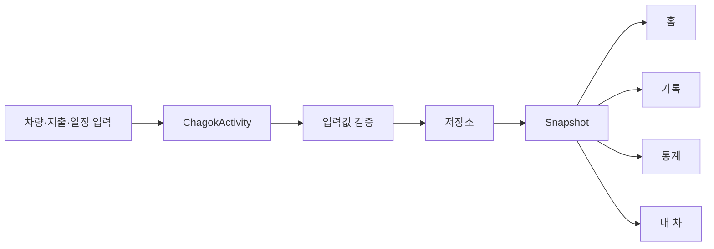

# 화면과 데이터 흐름

## 실제 앱

차곡의 기본 데이터는 차량 한 대, 지출 목록, 관리 일정 목록입니다. 화면에서 입력한 값을 검증하고 저장한 뒤 최신 스냅샷을 읽어 UI를 갱신합니다. 화면별 표시 방식은 다르지만 같은 스냅샷을 사용해 홈의 총지출과 기록·통계의 값이 일치하도록 구성했습니다.

UI 작업은 메인 스레드에서 처리하고 저장소 접근은 단일 실행 큐에서 처리합니다. 저장 실패는 화면의 안내 메시지로 전달하며, 저장 작업 중 중복 실행을 제한합니다. 화면 이동·월 선택·검색어·필터 상태는 Activity 상태에 보관합니다.

## 공개 코드 읽는 순서

1. `Models.kt`: Vehicle, Expense, Reminder와 Snapshot을 확인합니다.
2. `ChagokActivity.kt`의 `onCreate()`와 `render()`: 레이아웃 생성과 탭별 렌더링을 확인합니다.
3. `home()`, `history()`, `stats()`, `garage()`: 각 화면의 역할을 살펴봅니다.
4. `vehicleForm()`, `expenseForm()`, `reminderForm()`: 입력폼과 오류 안내를 확인합니다.
5. `CarStore.kt`: 공개용 예시 데이터가 화면에 전달되는 방식을 확인합니다.

공개 CarStore는 실제 제품의 DB 계층이 아닙니다. 클래스 이름과 화면 연결 형태를 유지하면서 구현을 메모리 기반 어댑터로 교체했습니다. AdsController와 ReminderJob 역시 실행하지 않는 대체 코드입니다.

## 디자인

- 오프화이트 배경, 흰색 입력폼, 짙은 녹색 액션과 연한 녹색 선택 상태
- 홈의 차량 카드와 월 총지출을 중심으로 정보 우선순위 설정
- 금액은 `Long`으로 표현하고 화면에서 원화 단위로 형식화
- 기록 검색과 필터는 목록을 갱신하며 상세 화면에서 수정·삭제 연결
- 하단 메뉴와 입력 시트로 주요 작업의 이동 단계를 줄임

실제 제품의 SQLite 스키마·복원 처리·광고 정책·백그라운드 실행·연비 핵심 알고리즘은 이 문서와 공개 코드에 포함하지 않습니다.
