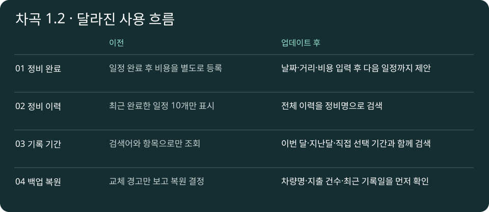

# 2026-11-11 · 차곡

- 차곡 1.2(6) 출시 · 정비 완료와 다음 일정, 전체 이력 검색, 기간 필터, 복원 미리보기

Google Play 프로덕션에 버전 1.2(버전 코드 6)를 출시했습니다. 첫 실행은 한국어로 시작하며 설정에서 영어·일본어·중국어 간체·스페인어도 선택할 수 있습니다.

- **정비 완료**에서 실제 날짜와 주행거리를 입력하고, 비용과 다음 교체까지의 거리 또는 개월 수를 선택해 한 번에 저장합니다.
- **내 차 → 정비 이력 전체 보기**에서 오래된 이력까지 정비명으로 검색하고 날짜와 주행거리를 확인합니다.
- **기록 → 기록 기간**에서 이번 달, 지난달 또는 직접 지정한 기간을 항목 필터·검색어와 함께 적용합니다.
- **설정 → 백업 복원**에서 기존 기록을 교체하기 전에 차량명, 지출 건수, 최근 지출일을 확인합니다.

제품 빌드와 단위 테스트가 성공했고, 에뮬레이터에서 언어·화면 이동·저장·복원 등을 다룬 테스트 12개를 통과했습니다. 정비 완료를 두 번 요청해도 비용이나 다음 일정이 중복되지 않는 경우를 검증했습니다.

[기록 기간 Kotlin 예제](../../devlog/examples/CarExamples.kt) · [Google Play에서 차곡 보기](https://play.google.com/store/apps/details?id=com.thirtythree_carmanagement)

## 화면으로 비교하기

에뮬레이터 테스트용 차량을 사용한 화면 참고 자료: [기록 탭](visuals/records.png) · [내 차 탭](visuals/garage.png). 위 비교 그림은 기능 차이를 설명한 도식입니다.

## 실제로 바뀐 코드

[화면 구현 전체](source/main/java/com/thirtythree_carmanagement/ChagokActivity.kt) · [1.1 작업본과 비교한 줄 단위 변경 내역](diff/changes.patch) · [다섯 언어의 문구와 디자인 리소스](source/main/res) · [Android 테스트 소스](source/androidTest/java/com/thirtythree_carmanagement)

| 기능 | 소스에서 확인할 내용 |
| --- | --- |
| 정비 완료 | ChagokActivity.kt의 `completeForm`: 날짜·주행거리·비용 입력과 다음 일정 제안 |
| 정비 이력 | 같은 파일의 `showHistory`: 완료 목록에서 정비명으로 검색 |
| 기록 기간 | 기록 화면에서 시작일·종료일, 검색어, 항목 조건을 함께 적용 |
| 복원 미리보기 | 선택한 백업의 요약을 표시하고 사용자 확인 후 복원 요청 |
| 중복 저장 방지 | [CarStoreTest.kt](source/androidTest/java/com/thirtythree_carmanagement/CarStoreTest.kt)의 정비 완료 테스트 |

이 폴더는 출시 소스 중 공개 가능한 파일을 그대로 보관한 스냅샷입니다. 개별 빌드용 프로젝트는 아닙니다. 실제 저장·복원 엔진, 연비 계산, 백그라운드 예약, 광고 운영 코드, 서명 설정은 [기존 공개 범위](../../docs/PUBLIC_SCOPE.md)에 따라 제외했습니다.

- 실제 화면 소스·리소스·테스트, 화면 참고 자료와 변경 비교 패치 공개
